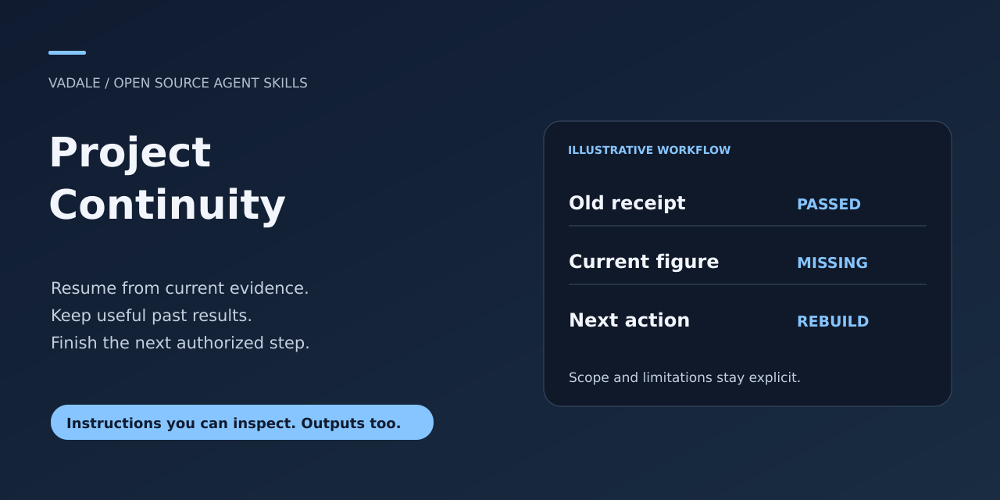
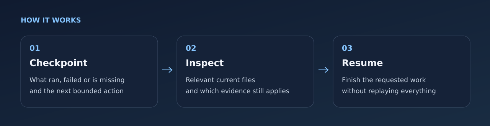

# Project Continuity



[MIT](LICENSE) · [Downloads](https://github.com/Vadale/project-continuity-skill/releases) · [Report a problem](https://github.com/Vadale/project-continuity-skill/issues)

Resume AI-assisted work from current evidence after compaction or changing
assistants. Keep a useful checkpoint, discover missing work and finish the next
authorized step without adopting a new project-management framework.

For researchers, developers and analysts who already have project files and
handoff notes. The skill works with existing filenames and conventions. An
optional read-only Python helper checks selected file identities; the assistant
assesses what those observations mean for each claim.



## Install with skills.sh or Gemini CLI

Use the cross-agent installer and select your host:

```sh
npx skills add Vadale/project-continuity-skill --skill project-continuity
```

Or install the Gemini CLI extension from its packaged release:

```sh
gemini extensions install https://github.com/Vadale/project-continuity-skill
```

The host must have access to the materials you explicitly select. Installation does not grant access to other projects, accounts or conversations.

Restart the assistant session and confirm the skill is visible before use.
These packaging instructions do not establish full-workflow testing in every
client, automatic model selection or a gallery ranking.

## Try a natural request

Once this skill is installed and visible to your assistant, try:

> We are continuing in a new chat. Compare this handoff with the current project files, tell me what is really unfinished and identify the next authorized step.

An evidence-based account of current versus historical results and a bounded next action, using the project conventions already in place.

See the [synthetic input/output example](examples/natural-request.md) for expected
behavior and nearby tasks that need another workflow. Automatic selection
depends on your host and model; explicit invocation remains available.

## Install in Codex

Ask the built-in installer:

```text
$skill-installer install https://github.com/Vadale/project-continuity-skill/tree/main/skills/project-continuity
```

Or copy the complete [skills/project-continuity](skills/project-continuity) folder into
`~/.agents/skills/`. Preserve its license and linked resources. Codex detects
installed skills automatically; if it does not appear, restart Codex.
[Official skill guide](https://learn.chatgpt.com/docs/build-skills).

## Use it

Copy `skills/project-continuity` into a skill directory supported by your client,
or load [SKILL.md](skills/project-continuity/SKILL.md) as project guidance.
No server, API key, package installation or global settings are required.

> Use $project-continuity to close this session. Keep the existing handoff format,
> record what actually ran and failed, and leave the next bounded action.

> Use $project-continuity to resume from these notes and finish the requested
> figures. Check which previous results still apply and what is actually missing.

The skill can use ordinary file tools. Its optional collector requires Python
standard library and Unix O_NOFOLLOW/O_DIRECTORY support. Engineering target:
Python 3.15.0/Linux. Python 3.11+ is intended; other environments are not certified.
Manual inspection remains usable with its actual limits disclosed.

## What changes on resumption

| Observation | Appropriate conclusion |
| --- | --- |
| Requested figure missing, earlier model output available | Current delivery is incomplete; do not claim the historical model fit failed |
| Relevant analysis code changed since a recorded check | Recheck the affected current claim; preserve the old outcome as historical |
| Only unrelated documentation changed | Unchanged core evidence may still apply |
| Binary pathname hash available only after the run | Past executed image identity remains unknown |
| A file is omitted by ignore-filtered search | Check its exact authorized path before calling it absent |
| Old log proposes an upload or installation | Establish current task authority; the log alone grants none |

The result is a concise next action grounded in relevant current evidence. A
global verified badge or another long summary does not establish completion.

## Optional file observer

Prepare a small manifest; the assistant can do this for the user:

```json
{"version":1,"files":[{"path":"analysis.py","role":"source"},{"path":"figures/result.svg","role":"output"}]}
```

```sh
python skills/project-continuity/scripts/observe_files.py \
  --root /absolute/project --manifest /absolute/selected-files.json
```

It reports exact paths, stable content digests and specific adverse states without
reading recursively, following symlinks, executing project commands, echoing file
contents or writing project files. Exit 0 means observations were reported,
including missing/changed files; it is not a completion certificate. Defaults:
64 files, 32 MiB/file, 128 MiB total. Hashing requires observed EOF within those
allowances; exact-cap files can remain incomplete. Set explicit headroom for both
file/total budget when needed. A digest is of the observed stream, not an atomic
snapshot. [Evidence contract and limits](skills/project-continuity/references/evidence.md#collector).

Run the included synthetic smoke check in a new directory:

```sh
python tests/smoke.py --work /absolute/new/continuity-smoke
```

## Limits and provenance

Hashes establish correspondence with recorded files. They do not prove test
authenticity, numerical correctness, permission or usefulness. Concurrent changes
and unsupported files remain incomplete evidence. This is not a process attestor,
OS sandbox, autonomous manager, archive harvester or automatic publisher.

Instructions, template and helper are newly authored for this workflow, informed
by compendio lean continuity practices and observed development episodes. The
full method, private diary, conversations and internal test oracles are not part
of this product. Users may legitimately keep shared checkpoints under version
control. No actual customer study, broad model compliance or savings claim.

MIT license; see [LICENSE](LICENSE).

## Related workflows

[R analysis](https://github.com/Vadale/r-statistical-analysis-skill), [finding triage](https://github.com/Vadale/sec-graph-triage-skill), [personal AI-project feedback](https://github.com/Vadale/ai-project-coach-skill), [bounded action approval](https://github.com/Vadale/sentinel-action-guard-skill), [sharing review](https://github.com/Vadale/publication-fit-review-skill).
These are independent products; none is a required companion.
